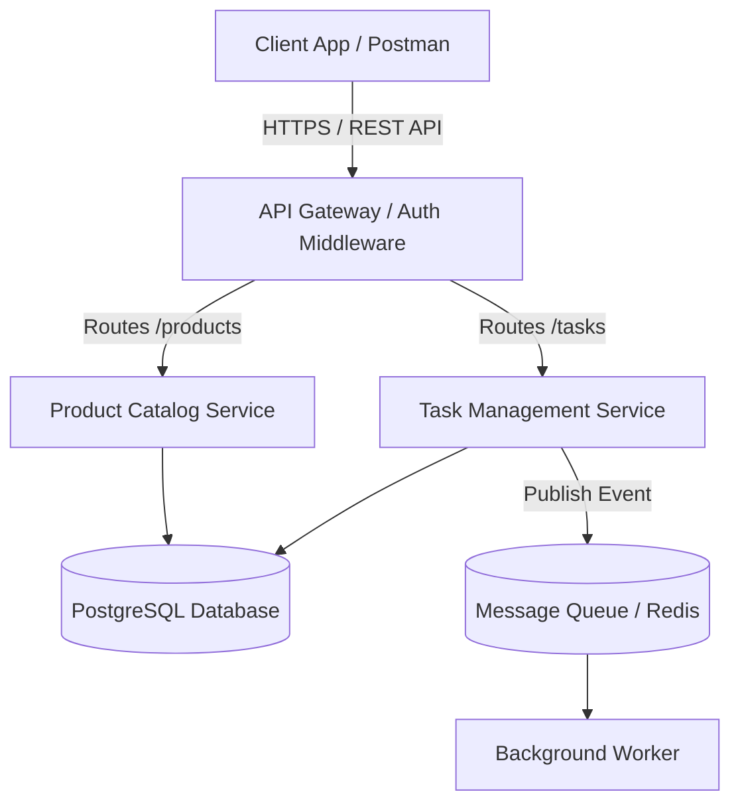
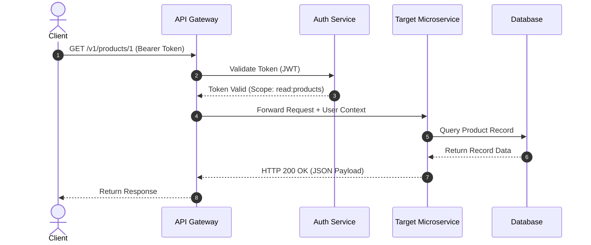
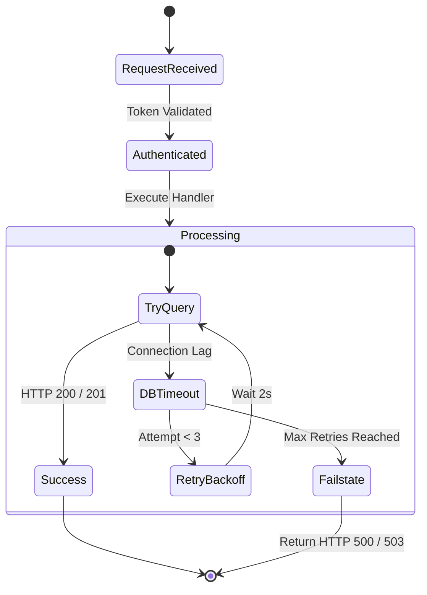

import Tabs from '@theme/Tabs';
import TabItem from '@theme/TabItem';

# System Architecture and Webhook Flows

This guide records the core system architecture of **The Product Catalog** ecosystem and illustrates how external client integrations interact with our background processing queues.

---

## 1. High level System Architecture

The following component diagram outlines how client requests flow from the edge gateway through microservices and into persistent storage.

## 2. Authentication and Request Lifecycle Sequence

When an authenticated client requests data or triggers action, the API gateaway validates token first then handing the execution over to the microservices layer.

## 3. Error Recovery and Retry Strategy

If a downstream service gets a temporary timeout or database lock, the gateway executes an exponential backoff retry pattern before returning a standard error payload.

